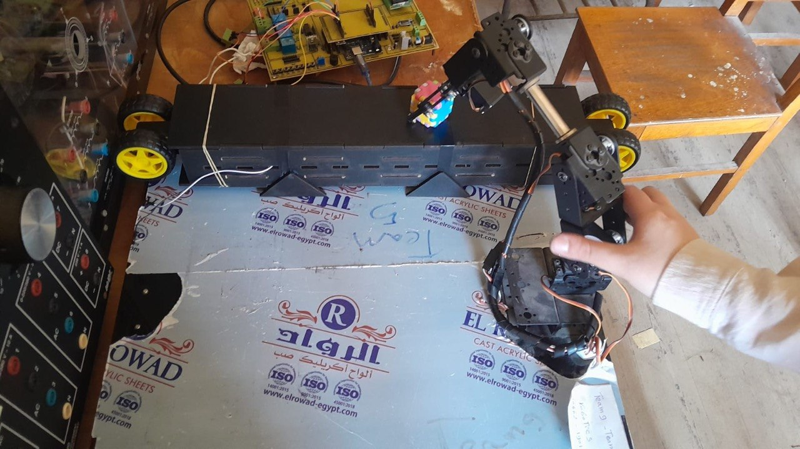
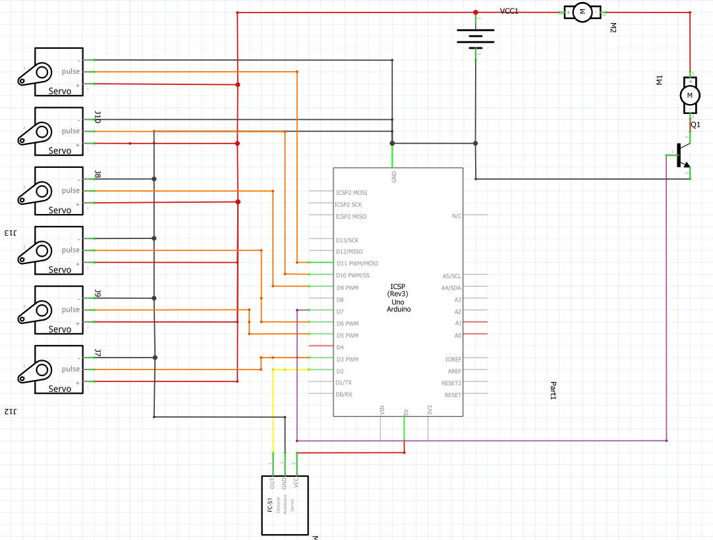
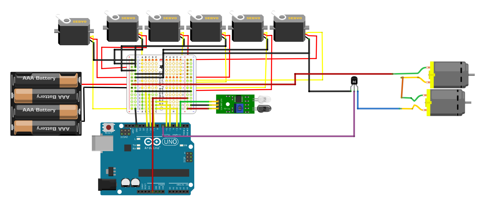
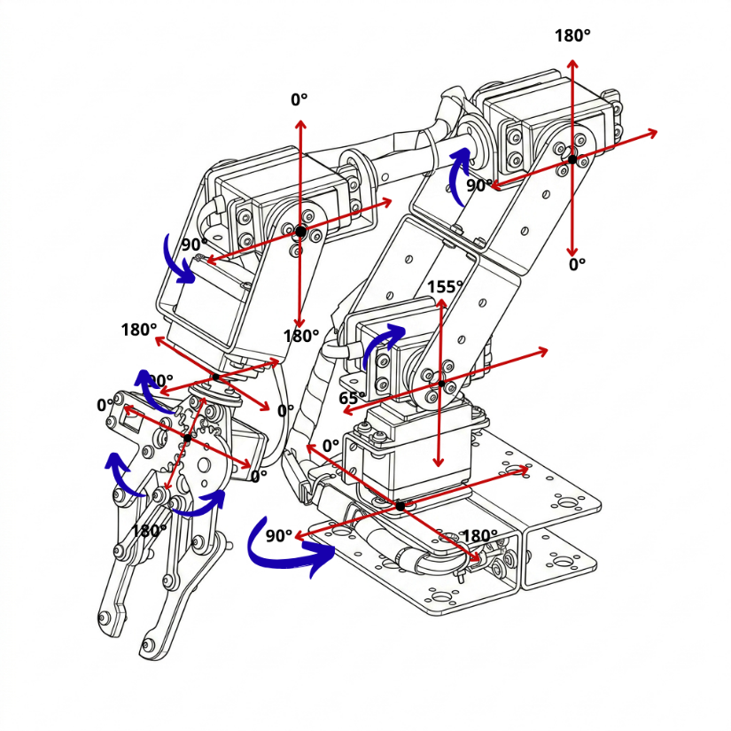
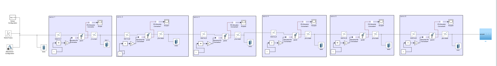
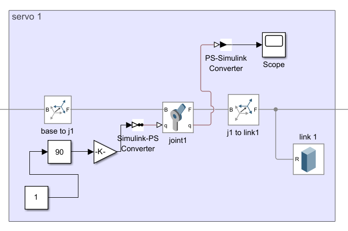
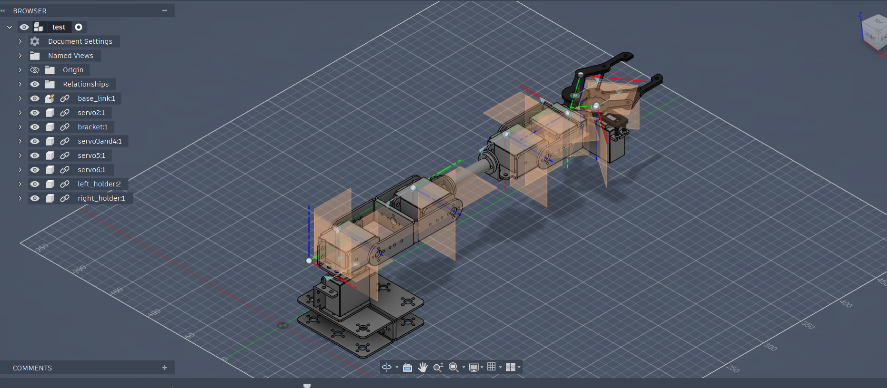
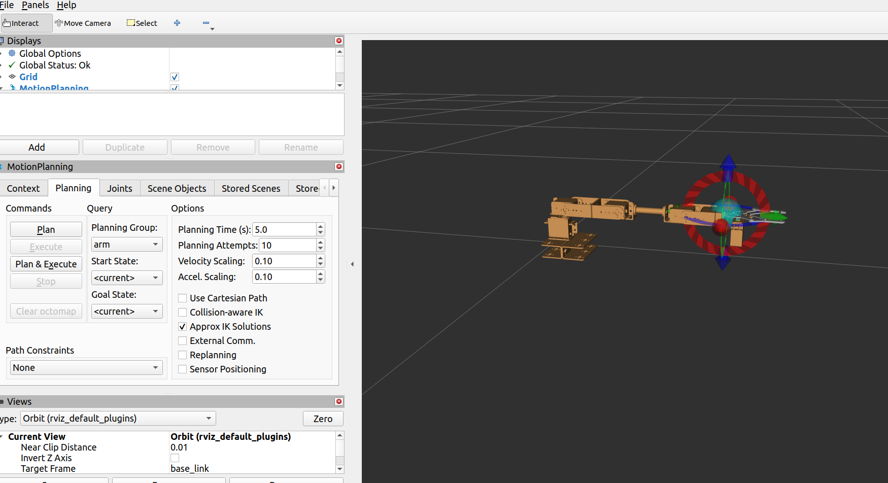
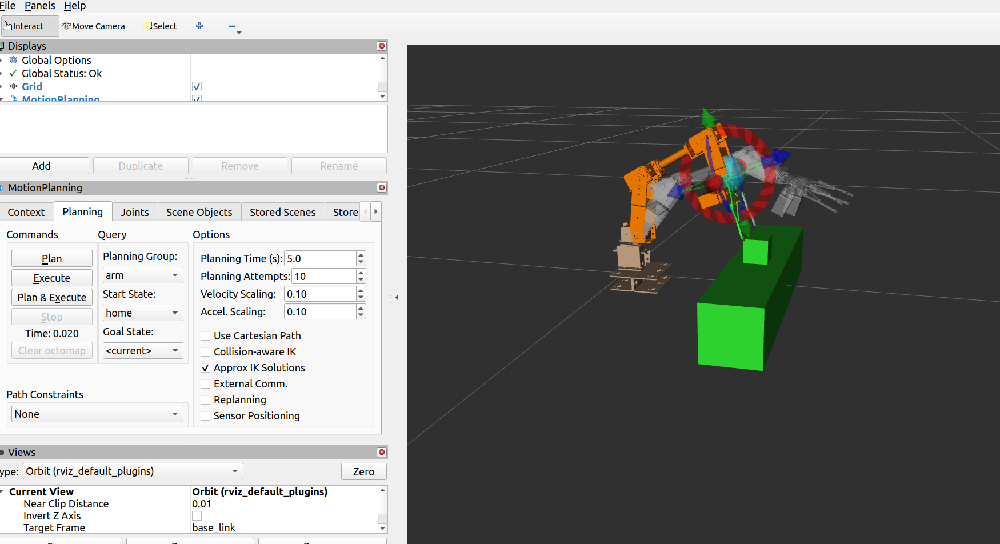

# Autonomous Sorting Robotic Arm: 6-DOF Manipulator with Conveyor Integration, Embedded Arduino Control, and ROS 2 / Simscape Digital Twin

<p align="center">
  
  
  
  
  
  
  
</p>

> **Project Engineer:** Abd El-Rhman Muhammad Saad  
> **Academic Institution:** Faculty of Engineering, Alexandria University (Class of 2026)  
> **Course & Specialization:** Robotics (Course Code: EEP 433) — Department of Electrical Engineering  
> **Academic Supervisor:** Prof. Dr. Mohammed El-Habrouk  
> **Project Title:** *SortArm-6DOF: Automated Conveyor Sorting Cell Using a 6-DOF Articulated Robotic Manipulator*  
> **Collaborative Engineering Team (Team 5):** Abd El-Rhman Saad, Mariem Mamdouh, Rowan Tamer, Nada Mahmoud, Marina Said, Asmaa Galal, Razan Ramzy, Tasneem El-Shandidi  
> **Project Repository:** [Autonomous-Sorting-Robotic-Arm on GitHub](https://github.com/Abd-El-Rhman-Saad/Autonomous-Sorting-Robotic-Arm)

---

## 📌 Architectural Overview



This repository presents the comprehensive engineering design, mechatronic fabrication, embedded control firmware, and digital-twin simulation suite for **SortArm-6DOF**: an automated, industrial-grade sorting cell featuring a **6-Degree-of-Freedom (6-DOF) articulated serial robotic manipulator** synchronized with a continuous-feed **motorized conveyor belt**. 

The robotic cell integrates optical infrared (IR) proximity detection, dynamic conveyor braking, multi-axis deterministic trajectory execution, and end-effector clamping to sort objects based on surface reflectance characteristics. Beyond physical hardware realization, the system is backed by two distinct digital-twin modeling pipelines:
1. **MATLAB / Simscape Multibody:** A forward multi-body physics simulation validating link mass distributions, joint angular transformations, and gravitational loading.
2. **ROS 2 & MoveIt 2 / RViz:** A forward and inverse kinematics (IK) motion planning workspace constructed from Fusion 360 STEP assembly files, exported via URDF/XACRO for obstacle avoidance and collision-free path synthesis.

---

## 🌟 Key Technical Features

- **6-DOF Articulated Kinematic Chain:** Constructed from robust anodized aluminum alloy brackets, driven by high-torque digital servomotors (SR-1501MG and MG996R) across six rotational degrees of freedom.
- **Synchronized Conveyor Cell:** Custom-fabricated $54.24\times 9.11\text{ cm}$ MDF conveyor driven by dual-shaft DC gearmotors, controlled dynamically through an NPN switching stage.
- **Embedded C++ State Machine:** Deterministic real-time firmware running on an ATmega328P microcontroller with interrupt-driven optical sensing and non-blocking subroutines.
- **Smooth Trajectory Generation (`moveSmooth`):** Custom software interpolation engine that ramps servo positions incrementally (10 ms time-slices), eliminating mechanical backlash, gear chatter, and high stall-current surges.
- **Interactive Serial Calibration Suite:** A dedicated diagnostic firmware utility that enables live tuning and angular sweeping over a 9600-baud UART terminal interface.
- **End-to-End Simulation Pipeline:** Complete kinematic models spanning Onshape/SolidWorks CAD, Autodesk Fusion 360 URDF translation, ROS 2 MoveIt 2 setup, and MATLAB Simscape Multibody blocks.

---

## ⚙️ Hardware Specifications & Bill of Materials (BOM)

| Subsystem | Component Name | Model / Specification | Engineering Function & Design Rationale |
| :--- | :--- | :--- | :--- |
| **Main Controller** | Microcontroller Board | Arduino Uno R3 (ATmega328P) | Central state machine, sensor monitoring, and multi-channel PWM servo timing |
| **Power Distribution** | Primary Servo Rail | 5V DC, 20A Switching Power Supply | High-current regulated DC rail ensuring zero voltage droop during peak 6-servo actuation |
| **Base Yaw (Joint S1)** | Digital Servo Motor | MG996R / Standard Digital | $180^\circ$ azimuth rotation of the entire manipulator arm ($11\text{ kg}\cdot\text{cm}$ torque) |
| **Shoulder Pitch (Joint S2)** | High-Torque Servo | SR-1501MG Digital Metal Gear | Heavy-duty shoulder elevation handling peak gravitational cantilever torque ($17\text{ kg}\cdot\text{cm}$) |
| **Elbow Pitch (Joint S3)** | Digital Metal Gear Servo | MG996R High-Torque | Forearm pitch articulation and extension profile ($11\text{ kg}\cdot\text{cm}$ torque) |
| **Wrist Pitch (Joint S4)** | Digital Servo Motor | MG996R / High-Torque | Elevation angle adjustment of the wrist assembly |
| **Wrist Roll (Joint S5)** | Digital Servo Motor | MG996R / Standard Servo | Axial rotation ($180^\circ$) of the mechanical end-effector |
| **End-Effector (Joint S6)** | Two-Finger Gripper | Mechanical Claw + Servo Drive | Precision parallel-jaw clamping mechanism for pick-and-place manipulation |
| **Conveyor Mechanics** | Conveyor Frame & Belt | MDF (4.8 mm CNC cut), $54.24\times 9.11\text{ cm}$ | Structural transport deck with low-friction roller alignment |
| **Conveyor Actuation** | DC Drive Motors | Dual-Shaft DC Gearmotors (3-6V) | Direct-drive traction rollers providing continuous material flow |
| **Motor Switching** | Transistor Driver Stage | NPN High-Current Transistor / L293D | Digital on/off logic switching driven by Arduino pin 7 with flyback protection |
| **Object Detection** | Proximity Sensor | Reflective IR Optical Sensor Module | Active-LOW digital threshold comparator distinguishing dark from light objects |
| **Acoustic Indicator** | Annunciator | 5V Active Buzzer | Audible operator warning alert triggered on object detection |

---

## 🔌 Hardware Architecture & Circuit Schematics

### 1. Electrical Interfacing & Pin Allocation
The sorting cell utilizes a common-ground dual-supply architecture. All servo motors draw power directly from the external 20A supply rail, while the Arduino Uno shares logic ground to prevent ground loops and inductive noise coupling:

```
+---------------------------------------------------------------------------------------+
|                                    POWER ARCHITECTURE                                 |
|                                                                                       |
|   +-----------------------+                    +----------------------------------+   |
|   | 5V / 20A DC Supply   |----[+5V Rail]----->| Servo Motors VCC (S1 through S6) |   |
|   | (External Regulated)  |----[GND Rail]--+   | Conveyor DC Motors (+)           |   |
|   +-----------------------+                |   +----------------------------------+   |
|                                            |                                          |
|                                            +---+ [Common Ground Reference]            |
|                                            |                                          |
|   +-----------------------+                |   +----------------------------------+   |
|   | Arduino Uno (USB/Vin) |----[GND Pin]---+-->| Sensor Grounds (IR, Driver, etc.)|   |
|   +-----------------------+                    +----------------------------------+   |
+---------------------------------------------------------------------------------------+
```

| Arduino Pin | Interface Type | Connected Hardware | Functional Description |
| :---: | :---: | :---: | :--- |
| **Pin 2** | Digital Input | Optical IR Proximity Sensor | Active-LOW payload arrival trigger at conveyor checkpoint |
| **Pin 3** | Digital PWM | Joint S1: Base Yaw Servo | Azimuth horizontal rotation ($0^\circ - 180^\circ$) |
| **Pin 5** | Digital PWM | Joint S2: Shoulder Pitch Servo | Main vertical elevation joint ($65^\circ - 140^\circ$) |
| **Pin 6** | Digital PWM | Joint S3: Elbow Pitch Servo | Forearm extension / retraction ($0^\circ - 180^\circ$) |
| **Pin 7** | Digital Output | Conveyor Motor Driver (NPN Base) | High = Conveyor Run, Low = Conveyor Stop |
| **Pin 8** | Digital Output | 5V Active Status Buzzer | Audible confirmation beep on valid detection |
| **Pin 9** | Digital PWM | Joint S4: Wrist Pitch Servo | Wrist vertical pitch adjustment ($0^\circ - 180^\circ$) |
| **Pin 10** | Digital PWM | Joint S5: Wrist Roll Servo | Wrist axial orientation ($0^\circ - 180^\circ$) |
| **Pin 11** | Digital PWM | Joint S6: End-Effector Gripper | Gripper jaw clamping ($110^\circ = \text{Open}, 150^\circ = \text{Clamped}$) |

### 2. Circuit Schematics & Bench Wiring

| Schematic Circuit Diagram | Bench Wiring Layout |
| :---: | :---: |
|  |  |

---

## 🦾 Kinematic Modeling & Joint Calibration



### 1. Joint Limits & Pose Matrix
Each joint was experimentally mapped to establish mechanical safety envelopes, neutral states, and deterministic target coordinates:

| Joint Identifier | Anatomical Joint | Servo Model | Min Angle | Calibrated Center | Max Angle | Home Pose | Pre-Pick Pose | Grip Pose | Release Pose |
| :---: | :---: | :---: | :---: | :---: | :---: | :---: | :---: | :---: | :---: |
| **S1** | Base Yaw | MG996R | $0^\circ$ (Right) | $90^\circ$ (Center) | $180^\circ$ (Left) | $90^\circ$ | $80^\circ$ | $80^\circ$ | $150^\circ$ |
| **S2** | Shoulder Pitch | SR-1501MG | $65^\circ$ (Rest) | $105^\circ$ (Mid) | $140^\circ$ (Peak) | $105^\circ$ | $140^\circ$ | $110^\circ$ | $110^\circ$ |
| **S3** | Elbow Pitch | MG996R | $0^\circ$ (Fold) | $90^\circ$ (Mid) | $180^\circ$ (Reach) | $120^\circ$ | $110^\circ$ | $110^\circ$ | $110^\circ$ |
| **S4** | Wrist Pitch | MG996R | $0^\circ$ (Down) | $90^\circ$ (Mid) | $180^\circ$ (Up) | $30^\circ$ | $80^\circ$ | $80^\circ$ | $80^\circ$ |
| **S5** | Wrist Roll | MG996R | $0^\circ$ (Right) | $90^\circ$ (Mid) | $180^\circ$ (Left) | $90^\circ$ | $160^\circ$ | $160^\circ$ | $160^\circ$ |
| **S6** | Gripper Claw | Standard Micro | $110^\circ$ (Open) | $130^\circ$ (Mid) | $170^\circ$ (Full Clamped) | $120^\circ$ | $110^\circ$ | $150^\circ$ | $110^\circ$ |

---

## 💻 Firmware Architecture & State Machine

```
               +---------------------------------------+
               |            System Boot / Init         |
               | - Attach 6 Servo PWM Pins (3,5,6,9,10,11)|
               | - Configure Pin Modes (IR, Conveyor)  |
               | - Move Smoothly to Home Pose          |
               +-------------------+-------------------+
                                   |
                                   v
+--------------------------------->+<--------------------------------+
|                                  |                                 |
|                                  v                                 |
|              +---------------------------------------+             |
|              |         STATE 0: Idle Running         |             |
|              | - Conveyor Motor: HIGH (Active)       |             |
|              | - Manipulator: Home Pose (Stationary) |             |
|              | - Polling IR Sensor (Pin 2)           |             |
|              +-------------------+-------------------+             |
|                                  |                                 |
|                   [IR == LOW] Target Box Detected                  |
|                                  |                                 |
|                                  v                                 |
|              +---------------------------------------+             |
|              |       STATE 1: Braking & Alert        |             |
|              | - Conveyor Motor: LOW (Stopped)       |             |
|              | - Trigger Buzzer Pulse (200 ms)       |             |
|              +-------------------+-------------------+             |
|                                  |                                 |
|                                  v                                 |
|              +---------------------------------------+             |
|              |       STATE 2: Pre-Pick Alignment     |             |
|              | - pickPosition_1: S1=80, S2=140,      |             |
|              |   S3=110, S4=80, S5=160, S6=110 (Open)|             |
|              +-------------------+-------------------+             |
|                                  |                                 |
|                                  v                                 |
|              +---------------------------------------+             |
|              |       STATE 3: Descent & Clamping     |             |
|              | - pickPosition_2: S2 drops to 110 deg |             |
|              | - gripPosition:   S6 closes to 150 deg|             |
|              +-------------------+-------------------+             |
|                                  |                                 |
|                                  v                                 |
|              +---------------------------------------+             |
|              |       STATE 4: Transfer to Bin        |             |
|              | - releasePosition: S1 pivots to 150 deg|            |
|              | - ungripPosition:  S6 opens to 110 deg|             |
|              +-------------------+-------------------+             |
|                                  |                                 |
|                                  v                                 |
|              +---------------------------------------+             |
|              |       STATE 5: Reset & Resume         |             |
|              | - Return to Home Pose                 |             |
|              | - Debounce Delay (1000 ms)            |             |
|              | - Restart Conveyor Motor (HIGH)       |             |
|              +-------------------+-------------------+             |
|                                  |                                 |
+----------------------------------+---------------------------------+
```

### Key Firmware Files
1. **`Firmware/SortArm_Autonomous_Operation/SortArm_Autonomous_Operation.ino`**:
   Full standalone autonomous sorting sketch. Implements the non-blocking state machine, IR debouncing, emergency conveyor stop, and deterministic angular positions.
2. **`Firmware/SortArm_Joint_Calibration/SortArm_Joint_Calibration.ino`**:
   Interactive calibration sketch. Listens for human-readable ASCII commands over UART (`A 90 B 120...`) and executes smooth position ramping (`moveSmooth`) to prevent mechanical shock.

---

## 🔬 Multi-Domain Simulation & Digital Twins

### 1. MATLAB Simscape Multibody Simulation
A complete 3D dynamic model was implemented in **Simscape Multibody** to simulate forward dynamics, gravity vector forces ($g = [0, 0, -9.81]\text{ m/s}^2$), and internal joint constraints:
- **Solver Configuration:** Physical network solver with automatic stiff integration.
- **Rigid Transforms:** Defined translation vectors representing physical link lengths and Euler rotation matrices matching servo bracket offsets.
- **Joint Subsystems:** Revolute joints with internal angle actuation (Simulink-PS Converter) and real-time angle/torque feedback logging (PS-Simulink Converter).

| Simscape Top-Level Physical Network | Joint Actuation Subsystem Architecture |
| :---: | :---: |
|  |  |

---

### 2. ROS 2 & MoveIt 2 Motion Planning
To enable autonomous trajectory synthesis and collision-free path planning, the physical CAD model was integrated into the **ROS 2 Humble/Iron** robotics ecosystem:
1. **Autodesk Fusion 360 to URDF:** The 30+ SolidWorks assembly components were unified in Fusion 360, where kinematic joint origins and local Z-axis rotation vectors were assigned. The programmatic Fusion 360 URDF exporter generated the comprehensive `.urdf` and `.xacro` descriptions with precise inertial tensors.
2. **MoveIt Setup Assistant:** Configured joint planning groups (`arm` and `gripper`), defined virtual joint world frames, and computed the Self-Collision Matrix to eliminate false collision positives between adjacent brackets.
3. **RViz Trajectory Execution:** Launched via `demo.launch.py`. MoveIt's KDL/OMPL inverse kinematics solver computes smooth, collision-free paths from initial poses to goal grasping configurations.

| Fusion 360 CAD & URDF Export | MoveIt Setup Assistant Groups | RViz Trajectory Simulation |
| :---: | :---: | :---: |
|  |  |  |

---

## 🛠️ Field Testing, Diagnostics & Troubleshooting

During laboratory testing and continuous-cycle runs on the physical test bench, three critical engineering bottlenecks were diagnosed and resolved:

```
[Issue 1: Gripper Servo Thermal Cutout & Burnout]
Cause:
  Commanding Joint S6 to a strict 170-degree mechanical limit caused the jaws to press
  against rigid plastic boxes before completing the commanded sweep, locking the servo in a
  continuous high-current STALL state (>1.8 A), leading to thermal runaway.
Solution:
  Calibrated the clamping angle to a narrow 150-degree threshold and integrated compliant
  foam pads on the mechanical jaws, reducing holding current to <200 mA.

[Issue 2: Joint S2 (Shoulder) Torque Deficit & Droop]
Cause:
  When the arm fully extends horizontally, the gravitational cantilever torque exceeded the
  nominal torque rating of budget 9g/MG990 servos, causing angle sag and gear chatter.
Solution:
  Upgraded Joint S2 to the SR-1501MG high-torque digital servo (17 kg*cm) and re-sequenced
  the trajectory to keep the shoulder angle elevated (140 deg) until the base completes its yaw.

[Issue 3: Microcontroller Brownout Resets during Servo Acceleration]
Cause:
  Sudden simultaneous multi-servo acceleration pulled instantaneous current surges exceeding
  4 A, inducing a voltage dip on the shared power rail that triggered the Arduino brownout reset.
Solution:
  Fully separated the servo power rail onto a dedicated 5V 20A supply, tied grounds at a single
  star point, and implemented the moveSmooth() software acceleration algorithm.
```

---

## 📂 Repository Structure

```plaintext
Autonomous-Sorting-Robotic-Arm/
├── Firmware/
│   ├── SortArm_Autonomous_Operation/
│   │   └── SortArm_Autonomous_Operation.ino    # Main automated sorting sketch (IR detection + state machine)
│   └── SortArm_Joint_Calibration/
│       └── SortArm_Joint_Calibration.ino       # Interactive calibration & serial angle sweep utility
├── Docs/
│   ├── Robotic_Arm_Booklet.pdf                 # Complete official academic laboratory report (PDF)
│   ├── Testing_and_Calibration.xlsx            # Servo limit angles and position matrix spreadsheet
│   └── Positions_angles.pptx                   # Joint angle breakdown presentation
├── images/                                     # High-resolution documentation figures and lab photos
│   ├── System_01_Assembled_Cell.png            # Complete assembled robotic sorting cell
│   ├── System_02_Mechanical_Design.png         # 6-DOF CAD & joint layout
│   ├── System_03_Conveyor_Design.png           # Conveyor belt CAD & dimensional drawing
│   ├── Hardware_01_Wiring_Schematic.png        # Complete electrical circuit diagram
│   ├── Hardware_02_Breadboard_Wiring.png       # Hardware connection layout
│   ├── Kinematics_01_Joint_Axes_Angles.png     # Servo rotation directions & limits
│   ├── Simscape_01_Multibody_Model.png         # MATLAB Simscape physical network
│   ├── Simscape_02_Joint_Subsystem.png         # Simscape joint subsystem blocks
│   ├── ROS2_01_Fusion360_URDF_Export.png       # Autodesk Fusion 360 URDF pipeline
│   ├── ROS2_02_MoveIt_Setup_Assistant.png      # MoveIt planning group configuration
│   ├── ROS2_03_RViz_Motion_Planning.png        # RViz trajectory simulation
│   └── Lab_01_Hardware_Prototype.jpg           # Physical bench prototype in lab
└── README.md                                   # Comprehensive repository documentation
```

---

## 🚀 Getting Started & Execution Guide

### 1. Hardware Setup
1. Mount the 6-DOF robotic manipulator firmly beside the conveyor pickup zone.
2. Wire the 6 servo PWM signal leads to Arduino digital pins `3, 5, 6, 9, 10, 11`.
3. Connect all servo positive ($V_{CC}$) and ground ($GND$) lines to the external **5V 20A power supply**.
4. Bridge the external power supply $GND$ to the Arduino $GND$ pin.
5. Wire the IR sensor module output to Arduino pin `2`, and the conveyor motor driver transistor base to pin `7`.

### 2. Firmware Flashing & Calibration
1. Open `Firmware/SortArm_Joint_Calibration/SortArm_Joint_Calibration.ino` in the Arduino IDE.
2. Select **Board: Arduino Uno** and the corresponding COM port.
3. Upload the sketch and open the **Serial Monitor** at **9600 baud**.
4. Test individual joint angles by entering commands (e.g., `A 90 B 120 C 60 D 50 E 90 F 120`) to verify mechanical limits.
5. Once aligned, open `Firmware/SortArm_Autonomous_Operation/SortArm_Autonomous_Operation.ino` and upload it to begin autonomous sorting.

---

## 🏛️ Academic Context & Engineering Team

This project was developed within the academic curriculum of the **Department of Electrical Engineering, Faculty of Engineering, Alexandria University**:

- **Course:** Robotics (Course Code: EEP 433)
- **Supervising Professor:** Prof. Mohammed El-Habrouk
- **Academic Year / Defense:** 2026
- **Engineering Project Team (Team 5):**
  - **Abd El-Rhman Muhammad Saad Muhammad** (ID: 19017058)
  - **Mariem Mamdouh Ibrahim** (ID: 21011335)
  - **Rowan Tamer Ismail** (ID: 21010537)
  - **Nada Mahmoud Youssef** (ID: 21011026)
  - **Marina Said Botros** (ID: 21011026)
  - **Asmaa Galal Ahmed** (ID: 19015429)
  - **Razan Ramzy Mohammed** (ID: 21010515)
  - **Tasneem Alaa El-Shandidi** (ID: 21010396)

---

## 📄 License

This project is licensed under the [MIT License](LICENSE) - open for educational, academic, and non-commercial development with proper attribution.

---

## 📬 Contact & Author Details

[](https://linkedin.com/in/Abd-El-Rhman-Saad)
[](https://github.com/Abd-El-Rhman-Saad)
[](mailto:abdelrhmanmsaad22@gmail.com)
